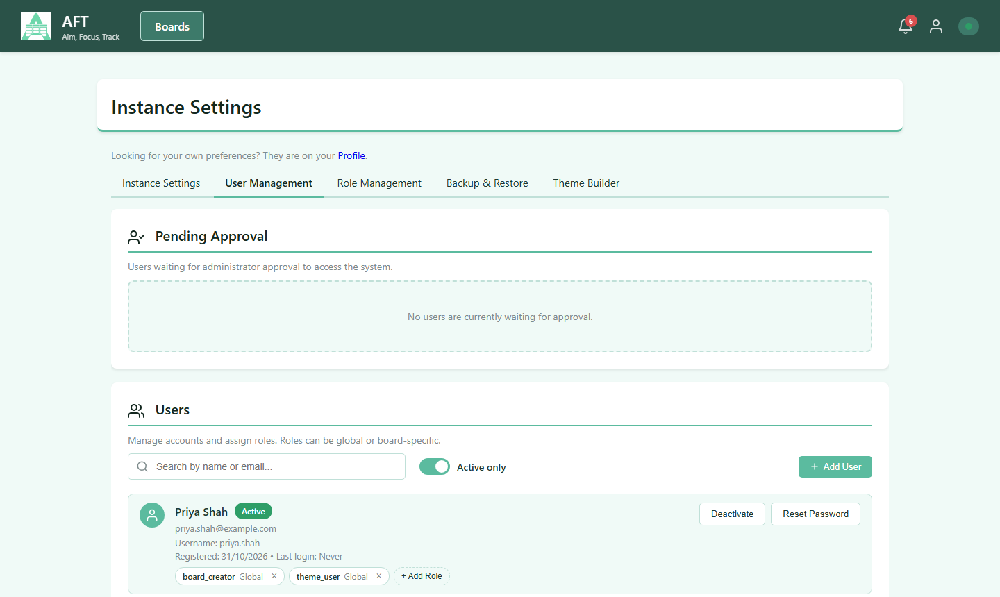
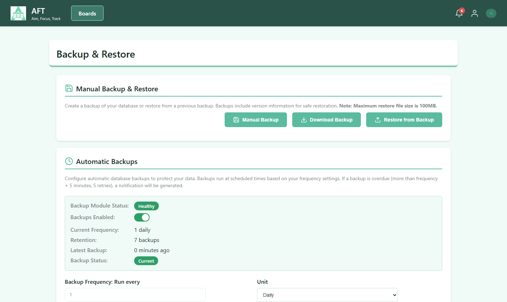
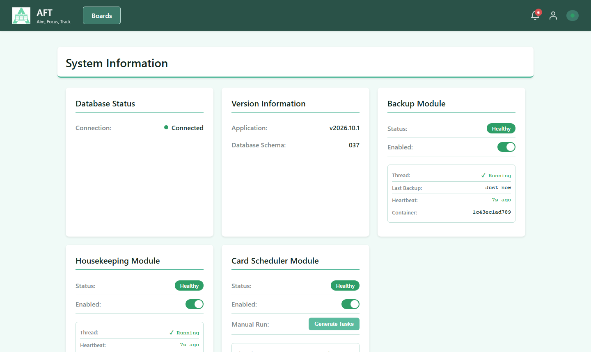
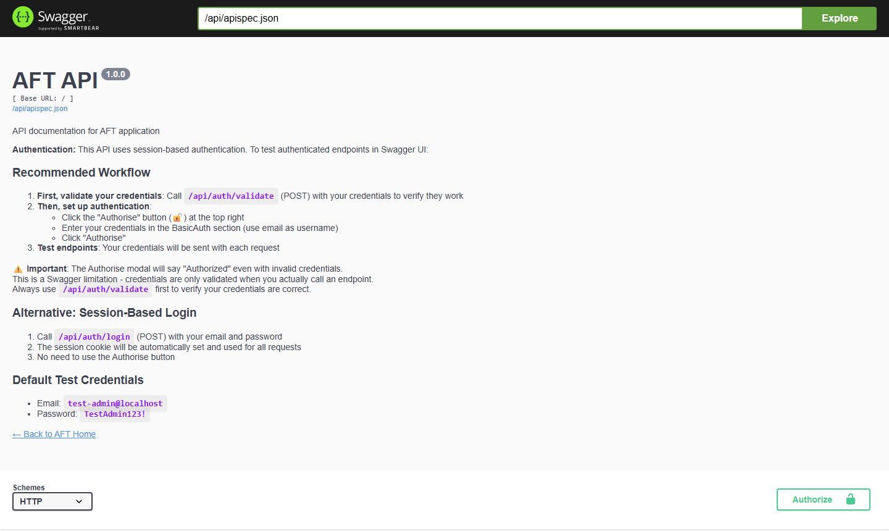

# Administration

For the people who install and run AFT. To install it for the first time, follow the [quick start](https://github.com/sjefferson99/aft#quick-start).

## Upgrading

To pull the latest release:

```sh
docker compose pull && docker compose up -d
```

Keep your deployed `compose.yml` aligned with the latest `compose.example.yml`. Older or custom compose files can miss required settings and silently break features, such as the nginx `env_file` that embed policy needs. Refresh your compose template first and merge any new service or env settings:

```sh
curl -o compose.example.yml https://raw.githubusercontent.com/sjefferson99/aft/main/compose.example.yml
diff -u compose.yml compose.example.yml
```

Then recreate the services so env changes take effect:

```sh
docker compose up -d --force-recreate
```

Available images, both published for `linux/amd64` and `linux/arm64`, so the same compose file works on a Raspberry Pi:

- `ghcr.io/sjefferson99/aft:latest`: API server only
- `ghcr.io/sjefferson99/aft-web:latest`: nginx and the UI, which proxies to the server

The images are public, so pulling needs no login. For a private fork, log in first with `docker login ghcr.io`.

### Server-only Deployment

Remove or comment out the `nginx` service in `compose.example.yml` before renaming it to `compose.yml` to run the API server without the web UI.

## Instance Settings

**Instance Settings** in the user menu holds the settings for the whole instance, in tabs. You only see the tabs your permissions allow.

- **Instance Settings**: the default theme, and promoting or demoting global themes
- **User Management**: one list for accounts and roles, including adding users and approving new registrations
- **Role Management**: build custom roles from individual permissions
- **Backup & Restore**: see [Backups](#backups)
- **Theme Builder**: see [Themes](user-guide.md#themes)



The instance default theme applies to new users when their account is created and to anonymous public board viewers. Existing users don't change. Only system themes and global themes can be selected, and the fallback is Fresh Green.

## Backups



The **Backup & Restore** tab runs manual backups and restores, and sets up automatic ones:

- Choose how often to run them, in minutes, hours or days, and the start time to align to
- Keep between 1 and 100 of the most recent backups
- The page shows backup health, and flags and notifies admins about overdue backups
- Restores show a spinner with the current step, and while data is loading, the table being restored and how much of the backup has been sent to the database

### Backup Storage

Automatic backups are stored on the host filesystem at `./backups/` (relative to the docker-compose.yml location). This directory is automatically created by Docker and persists across container restarts. You can include this directory in your host backup solution for additional data protection.

**Permission Requirements**: The container runs as a non-root user (UID 1000). If the `./backups/` directory is not writable, backups will fail with a permission error displayed in the UI. To fix this, run:

```bash
sudo chown -R 1000:1000 ./backups
sudo chmod -R 755 ./backups
```

## System Info



**System Info** in the user menu shows the application and database schema versions, database statistics and the status of the background services. Each service can be enabled or disabled there.

**Generate Tasks** lets admins choose a start and end date and time, preview exactly which cards would be created, then run the schedules for that range on demand.

### Background Services

- **Backup Scheduler** runs every minute. It makes backups at the configured times, enforces retention, checks disk space first, and notifies admins of failures and overdue backups
- **Card Scheduler** runs every minute. It creates cards from enabled schedules, enforces the duplicate rules, disables schedules past their end date, and notifies admins of errors
- **Housekeeping Scheduler** runs every hour. It checks GitHub for new AFT releases and creates one notification per version

## System Status Indicator

The header displays a real-time system status indicator in the top-right corner. It monitors three system components and shows their health:

| Status | Icon | Color | Meaning | Troubleshooting |
|--------|------|-------|---------|-----------------|
| **Connected** | ✅ | Green | All systems operational | None needed - everything is working normally |
| **Server Disconnected** | ❌ | Red | Cannot reach API server (blocks all operations) | Server is down, check docker containers with `docker compose ps`. Verify network connectivity. Try refreshing the page. |
| **WebSocket Disconnected** | ❌ | Red | Real-time updates unavailable (REST API still works) | Refresh page to reconnect. If persistent, check browser console for errors. Verify CORS settings in `.env`. **Note:** Database operations (create/edit/delete) still work via REST API. |
| **DB Error** | ❌ | Red | Database connection failed (blocks all operations) | Check database container health: `docker compose logs db`. Verify database is running and accessible. Check disk space. |

### Status Checking Order

The widget checks system status in this order and stops at the first failure:

1. **Server Connectivity** (Highest Priority)
   - Makes HTTP request to `/api/test`
   - If server doesn't respond or returns error, shows "Server Disconnected"
   - Other checks are skipped when server is down

2. **WebSocket Connection** (Medium Priority)
   - Only checked on board/dashboard pages (where real-time updates are needed)
   - Monitors Socket.IO connection status
   - If loading takes >30 seconds, shows "WebSocket Disconnected"
   - **Important:** WebSocket failures do NOT block database operations
   - REST API calls (create, edit, delete) continue to work normally
   - Only real-time sync features are affected (live updates from other users)

3. **Database Health** (Lower Priority)
   - Queries database directly via API
   - If server is OK but database fails, shows "DB Error"
   - Indicates database-specific issues

Status checks run every 5 seconds, and Socket.IO connect and disconnect events update it immediately. Socket.IO retries failed connections automatically, with an increasing delay.

## CORS Origins (HTTP/HTTPS/WebSocket)
The application enforces CORS (Cross-Origin Resource Sharing) on all web traffic: HTTP, HTTPS, and WebSocket connections. By default, CORS is restricted to localhost addresses for development safety. For production deployments or when accessing from different hosts, update the `CORS_ALLOWED_ORIGINS` environment variable in `.env`:

**Development (default):**
```
CORS_ALLOWED_ORIGINS=http://localhost,http://127.0.0.1,https://localhost,https://127.0.0.1
```

**Production (example with multiple trusted domains):**
```
CORS_ALLOWED_ORIGINS=https://yourdomain.com,https://www.yourdomain.com
```

**Custom Host / Docker Host Access:**
```
CORS_ALLOWED_ORIGINS=http://your-docker-host-ip,https://your-docker-host-ip,https://your-hostname
```

Provide a comma-separated list of all origins that should be allowed to connect, including the exact scheme and host you use in the browser (for example https://staustell). This prevents Cross-Site Request Forgery and Cross-Site WebSocket Hijacking attacks by only accepting connections from trusted sources.

## Public Board iframe Embedding (Trusted Sites)
If you plan to embed public boards on external websites, keep framing restricted to trusted partner origins only.

Set `EMBED_ALLOWED_ORIGINS` in `.env` as a comma-separated list of origins.
Both exact origins and controlled subdomain wildcard patterns are supported:

```
EMBED_ALLOWED_ORIGINS=https://partner-a.example,https://portal.partner-b.example
```

Example for an owned domain and all its subdomains:

```
EMBED_ALLOWED_ORIGINS=https://partner.example,https://*.partner.example
```

Notes:

- This setting is for frame-embedding allowlists (clickjacking protection), not API CORS.
- Keep the list minimal. If you use wildcard patterns, scope them to domains you control.
- Wildcard patterns (for example `https://*.partner.example`) do not include the apex domain; include both when required.
- The nginx service must load `.env` and pass `EMBED_ALLOWED_ORIGINS` into the container runtime. Both `compose.example.yml` and `compose.yml` include this by default; preserve it if you customize compose.
- After changing `.env`, recreate nginx so startup scripts regenerate CSP headers: `docker compose up -d --force-recreate nginx`.
- Public board iframe use and parent-site direct API calls are different:
  - iframe usage: board interactions run inside the AFT origin and should not require parent-origin CORS.
  - parent-site direct API calls: still require that parent origin in `CORS_ALLOWED_ORIGINS`.

### iframe Embed Troubleshooting
- "Refused to frame" in browser console:
  - Ensure the host origin is listed in `EMBED_ALLOWED_ORIGINS`.
  - Recreate/restart nginx so the runtime header include is regenerated.
- Board opens directly but not in partner site:
  - Confirm partner page uses the same exact scheme/host/port you allowlisted.
  - Confirm partner page is not forcing an overly restrictive iframe `sandbox`.
- Works on published page but fails in WordPress editor/preview:
  - The wp-admin/editor chain may introduce sandboxed or intermediate frame ancestors that do not match your allowlist.
  - Validate on the real published page URL (not `wp-admin` preview) before concluding embed policy is wrong.
- Partner site direct API calls fail with CORS:
  - Add partner origin to `CORS_ALLOWED_ORIGINS` (separate from iframe settings).

Use the lightweight validation assets to confirm header behavior:

- Checklist: [docs/EMBED_VALIDATION.md](https://github.com/sjefferson99/aft/blob/main/docs/EMBED_VALIDATION.md)
- Script: `powershell -ExecutionPolicy Bypass -File scripts/check-embed-policy.ps1 -BaseUrl https://localhost -ExpectedAllowedOrigins https://partner-a.example`

### Post-upgrade verification
After updating compose templates or changing `.env`, run these checks to confirm nginx is receiving embed origins and serving the expected CSP:

```sh
docker compose up -d --force-recreate nginx
docker exec aft-web sh -lc 'echo "EMBED_ALLOWED_ORIGINS=$EMBED_ALLOWED_ORIGINS"'
docker exec aft-web cat /etc/nginx/snippets/embed_frame_ancestors.inc
curl -I "https://<your-aft-host>/public-board.html?slug=<your-public-slug>"
```

Expected results:

- `EMBED_ALLOWED_ORIGINS` inside `aft-web` is non-empty.
- `embed_frame_ancestors.inc` includes your allowlisted origins after `'self'`.
- `Content-Security-Policy` on `/public-board.html` includes `frame-ancestors` with the same origins.

## HTTPS and Session Cookie Security
By default, the stack now enforces secure session cookies and redirects direct HTTP requests to HTTPS.

- Nginx auto-generates a self-signed certificate at startup when no certificate files exist, so HTTPS works out of the box without manual certificate setup.
- Flask defaults `SESSION_COOKIE_SECURE=true`, so browsers only send session cookies over HTTPS.
- The HTTP listener (port 80) redirects non-localhost traffic to HTTPS unless an upstream reverse proxy forwards `X-Forwarded-Proto: https`.

This keeps direct deployments secure by default while still supporting external reverse proxies and certificate resolvers.

## Passkeys
Users can sign in with a passkey (fingerprint, face, screen lock, a password manager, or a security key) instead of typing their password. Passkeys are an alternative way to sign in, not a second factor, and every account keeps its password.

Passkeys are **off until you set `WEBAUTHN_RP_ID`**. Once they are on:
- users add and manage passkeys from their **Profile** page (adding one asks for their current password)
- the login page shows a **Sign in with a passkey** button, and supported browsers also offer saved passkeys when you click the username field
- administrators can revoke all of a user's passkeys from **User Management**, for example after a lost device

### Before you turn them on
Browsers only allow passkeys when all of these are true:
- **AFT is reached by a domain name**, such as `aft.example.com`. Passkeys don't work when you browse to an IP address (`https://192.168.1.10`). Single-word LAN host names (`https://aft`) may not work in every browser.
- **The connection is HTTPS with a certificate the browser trusts.** Chrome and Edge turn passkeys off on pages with certificate errors, so the auto-generated self-signed certificate is not enough unless every device trusts it. Use a real certificate (for example from Let's Encrypt or your reverse proxy), or install your own CA on each device. `http://localhost` is the only exception, for development.
- **The domain stays the same.** Each passkey is tied to `WEBAUTHN_RP_ID`. If you change it later, or move AFT to a different domain, every existing passkey stops working and users must add new ones. Their passwords keep working.

### Settings
Add these to `.env` and restart the server (`docker compose up -d server`). An invalid value stops the server at startup with a message saying what is wrong.

| `.env` variable | Required | Default | What it does |
|---|---|---|---|
| `WEBAUTHN_RP_ID` | Yes, to turn passkeys on | (unset: passkeys off) | The domain passkeys are tied to, with no `https://`, port or path. For example `aft.example.com`. It can be a parent domain (`example.com`) if AFT is served from several subdomains of it. |
| `WEBAUTHN_ORIGINS` | No | `https://<WEBAUTHN_RP_ID>` | Comma-separated list of the exact addresses users open AFT at, including any port, for example `https://aft.example.com,https://aft.example.com:8443`. Each must be on `WEBAUTHN_RP_ID` or a subdomain of it, and must be `https` (only `http://localhost` is allowed for development). |
| `WEBAUTHN_RP_NAME` | No | `AFT` | The name browsers and password managers show next to the passkey. Up to 64 characters. |

Passkey sign-in also needs Redis (`REDIS_URL`), which the standard compose files already provide.

Example for a site at `https://boards.example.com`:

```
WEBAUTHN_RP_ID=boards.example.com
```

Example for local development at `http://localhost`:

```
WEBAUTHN_RP_ID=localhost
WEBAUTHN_ORIGINS=http://localhost,https://localhost
```

### Notes
- Revoking a user's passkeys ends any sessions that were signed in with them. Sessions signed in with a password continue, so also reset the user's password if a device was lost or stolen.
- A user who removes a passkey from their Profile page should also delete it from their device or password manager, or it will keep being offered on the login page.
- Two-factor authentication is a separate feature, tracked in [#587](https://github.com/sjefferson99/aft/issues/587).

## Database memory tuning
The `db` service runs MySQL with settings sized for small self-hosted installs. Stock MySQL defaults suit a dedicated database server, and in AFT they used 450–600 MB at idle. With the defaults below, idle memory is about 130 MB.

Every setting can be overridden in `.env` with the variable shown. Each is commented out in [.env.example](https://github.com/sjefferson99/aft/blob/main/.env.example), and `compose.yml` / `compose.example.yml` pass them to MySQL as command-line options with these defaults:

| `.env` variable | MySQL option | Default | MySQL stock | What it does / when to change it |
|---|---|---|---|---|
| `MYSQL_INNODB_BUFFER_POOL_SIZE` | `innodb_buffer_pool_size` | `32M` | `128M` | Caches table and index data in memory. 32 MB holds a typical AFT database. If your data is larger, raise it to at least the data size (see the query below) so reads come from memory. This is the main setting for larger installs. |
| `MYSQL_MAX_CONNECTIONS` | `max_connections` | `100` | `151` | Maximum concurrent client connections. Each gunicorn worker process can open up to 15 (SQLAlchemy pool of 5 plus overflow of 10), and backups and restores open a few more. Keep it above `15 × workers + 10`. If you see `Too many connections` errors, raise it. |
| `MYSQL_MAX_ALLOWED_PACKET` | `max_allowed_packet` | `128M` | `64M` | Largest single SQL statement or row MySQL accepts. Backups are restored as SQL, so if a restore fails with a `Got a packet bigger than 'max_allowed_packet'` error, raise it (for example to `256M`). |
| `MYSQL_INNODB_LOG_BUFFER_SIZE` | `innodb_log_buffer_size` | `4M` | `64M` | Buffers redo-log writes before they reach disk. AFT's writes are small. Raise it only if very large imports or restores are slow. |
| `MYSQL_TABLE_OPEN_CACHE` | `table_open_cache` | `200` | `4000` | Number of open table handles cached across sessions. AFT has under 20 tables, so 200 leaves plenty of headroom. You should not need to change it. |
| `MYSQL_PERFORMANCE_SCHEMA` | `performance_schema` | `OFF` | `ON` | MySQL's internal instrumentation, and the largest single memory consumer (~190 MB). AFT does not use it. Set it to `ON` only to diagnose MySQL performance problems. |

To check your data size, from the docker host:

```sh
docker exec aft-db sh -c 'mysql -uroot -p"$MYSQL_ROOT_PASSWORD" -e "SELECT ROUND(SUM(data_length + index_length) / 1024 / 1024) AS size_mb FROM information_schema.tables WHERE table_schema = \"$MYSQL_DATABASE\";"'
```

Example `.env` overrides for a larger install running 4 gunicorn workers (`GUNICORN_WORKERS=4`, see [Server workers and threads](#server-workers-and-threads)):

```sh
MYSQL_INNODB_BUFFER_POOL_SIZE=256M
MYSQL_MAX_CONNECTIONS=150
```

Apply changes by recreating the database container with `docker compose up -d db`. A plain `docker compose restart` does not pick up `.env` changes. The settings need no data migration, so existing data directories are unaffected. To confirm the values in effect:

```sh
docker exec aft-db sh -c 'mysql -uroot -p"$MYSQL_ROOT_PASSWORD" -e "SELECT @@innodb_buffer_pool_size, @@max_connections, @@max_allowed_packet, @@innodb_log_buffer_size, @@table_open_cache, @@performance_schema;"'
```

If `aft-db` keeps restarting after a change, a value is probably invalid (for example `100O` instead of `100`). MySQL names the bad option in its log, which you can see with `docker compose logs db`. Fix the value in `.env` and run `docker compose up -d db` again.

> **Upgrading from an older compose file:** these options live in the `command:` list of the `db` service. Merge that block from the latest `compose.example.yml` into your `compose.yml`, or the `.env` variables have no effect.

## Server workers and threads
The `server` container runs gunicorn with **1 worker process and 32 threads** by default. Idle memory is about 110 MB; the previous fixed setting of 4 workers × 8 threads used about 340 MB. You can change both values in `.env`:

| `.env` variable | Default | Allowed | What it does / when to change it |
|---|---|---|---|
| `GUNICORN_THREADS` | `32` | 1–128 | Threads per worker. Every open board or theme-builder tab keeps a live WebSocket connection that holds one thread for as long as it's open, and normal API requests share the rest. The thread count is therefore roughly the number of tabs one worker can serve at once. Threads cost very little memory (1 × 64 idles at the same ~110 MB as 1 × 32). If you regularly have more than about 25 tabs open, raise this first. |
| `GUNICORN_WORKERS` | `1` | 1–16 | Worker processes. Each extra worker adds about 80 MB, and it multiplies the thread count (workers × threads). One worker handles a typical self-hosted install. Add workers only if one worker's CPU becomes a bottleneck, for example many concurrent active users. Python runs only one thread at a time per process, so extra workers add CPU parallelism and extra threads don't. |

**If you add workers, check MySQL's connection limit.** Each worker can open up to 15 database connections, so `MYSQL_MAX_CONNECTIONS` must be above `15 × GUNICORN_WORKERS + 10` (see [Database memory tuning](#database-memory-tuning)). The default limit of 100 covers up to 6 workers. If the limit is too low, the server logs a warning at startup that gives the value to set.

Example `.env` for a busier install:

```sh
GUNICORN_WORKERS=2
GUNICORN_THREADS=64
```

Apply changes with `docker compose up -d server`. Invalid values, such as `0`, `abc` or anything outside the allowed range, stop the server from starting. The reason appears in `docker compose logs server`, for example `Invalid gunicorn setting: GUNICORN_WORKERS must be a whole number between 1 and 16, got '4O'`.

Multi-worker support is unchanged. Socket.IO broadcasts go through Redis, and the schedulers use file and database locks, so raising `GUNICORN_WORKERS` needs no other configuration.

**During a large database restore** with a single worker, other requests can slow to a few seconds while the backup file is read and validated, because that work runs in the same process. Requests return `503` while the database itself is being reloaded, whatever the worker count. The only exception is the progress route the restore page polls, `GET /api/database/restore/progress/<id>`, which doesn't use the database. In testing, a 75 MB restore took about 25 seconds in total.

## Sign-in rate limits
AFT slows down password guessing. After too many failed attempts, further attempts get a "Too many attempts" message until the block ends. Blocks end by themselves, and people who are already signed in aren't affected. A blocked account can still sign in with a passkey. Failed passwords count across sign-in, password changes and adding a passkey, and only failures count. Limits apply to unknown usernames too, so a block doesn't show whether an account exists.

**If another reverse proxy, such as Traefik, sits in front of the bundled nginx, set `TRUSTED_PROXY_HOPS=2`.** Otherwise every user appears to come from that proxy's address and shares one per-IP limit, so failed attempts by one person could block everyone's sign-in. Use the real number of proxies: a value that is too high lets clients fake their address by sending their own `X-Forwarded-For` header. If you run the server without nginx and nothing in front of it, set `TRUSTED_PROXY_HOPS=0`.

| `.env` variable | Default | Allowed | What it does |
|---|---|---|---|
| `TRUSTED_PROXY_HOPS` | `1` | 0 or more | Proxies in front of the server, counting the bundled nginx. Used to find each client's real IP address. |
| `AUTH_RATE_LIMIT_ACCOUNT_FAILURES` | `10` | 1 or more | Failed password attempts per account in 15 minutes. |
| `AUTH_RATE_LIMIT_IP_FAILURES` | `50` | 1 or more | Failed password attempts per client IP in 15 minutes, across all accounts. Raise this if many people share one public address, such as an office network. |
| `AUTH_RATE_LIMIT_REGISTRATIONS` | `10` | 1 or more | Registration attempts per client IP in an hour. Signed-in administrators creating users aren't limited. |
| `AUTH_RATE_LIMIT_PASSKEY_STARTS` | `60` | 1 or more | Passkey sign-ins started per client IP in a minute. |

Apply changes with `docker compose up -d server`. Invalid values stop the server from starting, and the reason appears in `docker compose logs server`. Blocked attempts are logged as warnings in the same place.

Blocks survive a restart of Redis. To clear every block early, without signing anyone out, run:

```sh
docker compose exec redis sh -c "redis-cli --scan --pattern 'aft:rl:auth:*' | xargs -r redis-cli del"
```

## Security and Access Control

The application includes a multi-user security model with authentication, role-based authorisation, and secure-by-default deployment settings.

- **Authentication Across HTTP + WebSocket** - Login/logout is enforced for protected API access and real-time socket connections.
- **Role-Based Access Control (RBAC)** - Supports global and board-specific roles with permission checks on backend endpoints.
- **Permission-Aware UI** - Frontend controls are shown/hidden based on effective permissions, reducing invalid actions before API calls.
- **Ownership and IDOR Protection** - Server-side scoping checks prevent users from accessing resources they do not own or are not assigned to.
- **Secure Session Defaults** - HTTPS-first behaviour, secure session cookies by default, and optional Redis-backed server-side sessions.
- **Passkeys (optional)** - Sign in with a passkey instead of a password, once an administrator sets the passkey domain. See [Passkeys](#passkeys).
- **Password Guessing Limits** - Repeated failed passwords are temporarily blocked per account and per client IP. See [Sign-in rate limits](#sign-in-rate-limits).
- **Operational Hardening** - Token-protected health checks and browser hardening headers in the reverse proxy layer.
- **Public Board Guardrails** - Anonymous access is limited to redacted read-only board payloads via slug URLs; private boards and all write/admin endpoints remain auth-gated.
- **Public Route Controls** - Public board endpoints include crawler-dissuasion/cache headers and request throttling to reduce abuse risk.

### Permissions and Users

- **Board Ownership and Sharing** - Boards are owned by a user, and access can be shared per board. Board-specific roles enable read-only access (viewer) or read/write collaboration (editor) without granting global access to all boards. Board owners and administrators can reassign ownership from the board menu on the board page.
- **Fine-Grained Per-Board Permissions** - Effective permissions are evaluated per board, so actions like editing or deleting are allowed only where the user has board-level rights.
- **Custom Role Construction** - Role management supports building custom roles from individual permission blocks, then assigning those roles to users within the allowed assignment scope.
- **Controlled Role Assignment** - Role changes require role-management permissions, with backend checks to prevent unauthorised escalation and invalid global vs board-specific assignments.
- **Registration and Approval Workflow** - New user registrations are created in a pending state and must be approved by an administrator before login access is granted.
- **First Admin Initial Setup** - A dedicated setup flow creates the first administrator account, auto-approves it, and completes initial bootstrap for the instance.
- **User Profile Colours** - Each user is assigned a default avatar/profile colour (RGB hex) on account creation and can update it from the Profile page.

For implementation details and extension guidance:
- [server/docs/AUTHENTICATION.md](https://github.com/sjefferson99/aft/blob/main/server/docs/AUTHENTICATION.md)
- [server/docs/PERMISSION_MODEL.md](https://github.com/sjefferson99/aft/blob/main/server/docs/PERMISSION_MODEL.md)
- [docs/PERMISSION_UI_SYSTEM.md](https://github.com/sjefferson99/aft/blob/main/docs/PERMISSION_UI_SYSTEM.md)

## API

Everything in AFT is available through the REST API, for integrations and automation. Open **API Docs** in the user menu for the interactive Swagger page, or go to `/api/docs` on your instance.


