# User Guide

AFT should be easy to use without reading anything first. This guide covers the details and the time-saving tricks.

## Keyboard Shortcuts

Use these keyboard shortcuts on a board to add, archive and reorder cards and add columns faster:

| Key | Action | Where it goes |
|---|---|---|
| <kbd>N</kbd> | Add a new card | **Top** of the column under your mouse |
| <kbd>M</kbd> | Add a new card | **Bottom** of the column under your mouse |
| <kbd>C</kbd> | Add a new column | **Nearest** your mouse: to the left of a column if you're over its left half, to the right if you're over its right half |
| <kbd>A</kbd> | Archive a card | The card **under** your mouse |
| <kbd>T</kbd> | Move a card to the top of its column | The card **under** your mouse |

To use these shortcuts:

- Move your mouse to where you want the card or column, then press the shortcut key
- After adding a card, press **N** or **M** again to quickly add another card to the same column, even if your mouse has moved off the board
- If you press **C** before moving your mouse, the new column is added at the end of the board
- In the Scheduled View, **N** and **M** add a scheduled card. **A** does nothing there
- Shortcuts don't work while typing in text fields, when a modal is open, or on boards you can't edit

## Boards

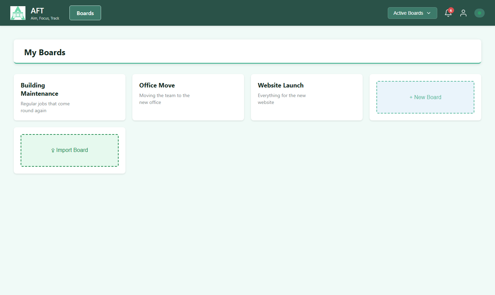

- **Create as many boards as you need**, and rename or delete them from the boards list
- **Archive a board** to clear it from the list and keep its data. Switch between Active Boards and Archived Boards in the header view menu to find it and unarchive it
- **Default board**: choose a board to open on startup in your [Preferences](#preferences)
- **Change the owner**: board owners and administrators can reassign ownership from the board menu
- **Share a board**: boards are owned by one user and shared per board, with viewer or editor access

### Importing Boards

Choose **Import Board** on the boards list. The import modal shows which cards will be affected before you confirm.

- **AFT JSON**: re-import any board exported from AFT, including columns, cards, card start and end dates, checklists, comments and scheduled cards. Assignees aren't carried over, because user IDs differ between instances. Imported boards are always private, even if the source board was public
- **Trello JSON**: labels are added to descriptions, URL attachments are appended, checklists and dates are mapped, and you can map Trello members to AFT users
- **CSV**: import cards from a spreadsheet with the columns `title`, `column`, `assignee`, `description`, `checklist_items` (separated by `|`; add `[done]` to mark an item checked), `start_date` and `end_date` (YYYY-MM-DD). The import modal has a link to a template

A CSV can create a new board, named after the file by default, or go into an existing board. For an existing board, choose what happens to cards that match on column and title:

- **Duplicate**: every CSV card is added as new, and matching cards get a number, for example `Card (2)`
- **Overwrite**: matching cards are replaced in place, and new cards are added

Cards with an unrecognised username are imported without an assignee, and you'll see a warning.

### Public Boards

Board owners and editors can make a board public from the board menu, so anyone with the link can view it without signing in.

- **Copy the link**: signed-in users see a small **P** badge in the header on public boards. Select it, or use **Copy Public Link** in the board menu
- **The link is stable**: making a board private and then public again keeps the same link
- **Rotate Public Link** in the board menu stops the old link working immediately and issues a new one
- **Read only**: public boards have no edit controls and don't show assignees or who wrote a comment
- **Theme**: public boards use the instance default theme

To embed a public board in another website, see [Public Board iframe Embedding](administration.md#public-board-iframe-embedding-trusted-sites).

## Columns

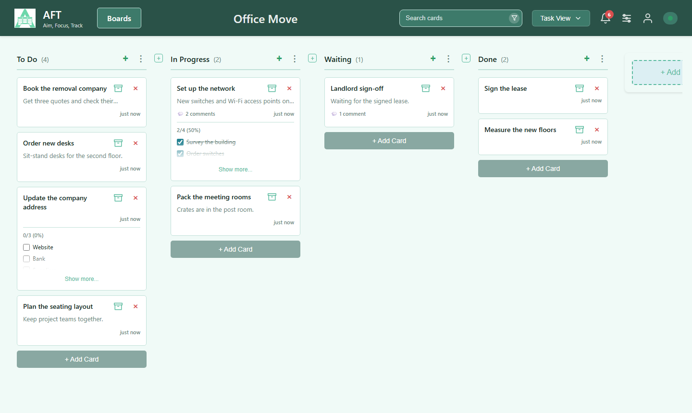

Long column names show on two lines. To see the full name, hover over it, or click or tap it to expand it.

### Adding Columns

If you can edit a board, there are three ways to add a column:

- **Between two columns** - Select the small **+** in the gap between two column headers. The new column goes in that gap. The **+** isn't shown in small windows or on phones
- **With the keyboard** - Press **C** to add a column nearest your mouse (see [Keyboard Shortcuts](#keyboard-shortcuts)). This is also the quickest way to add a column before the first one
- **At the end of the board** - Scroll to the end of the board and select **+ Add Column**

### Column Menu

The three-dots menu on a column has these actions:

- **Move All Cards**: move every card to another column, at the top or bottom
- **Archive All Cards**: archive all the active cards in the column
- **Archive After...**: archive cards older than a period you choose, such as 7 days, 2 weeks or 3 months. It uses each card's last update time, and shows a preview including the most recent card that would be archived
- **Unarchive All Cards**: shown in the Archived View
- **Delete All Cards** and **Delete Column**

## Cards

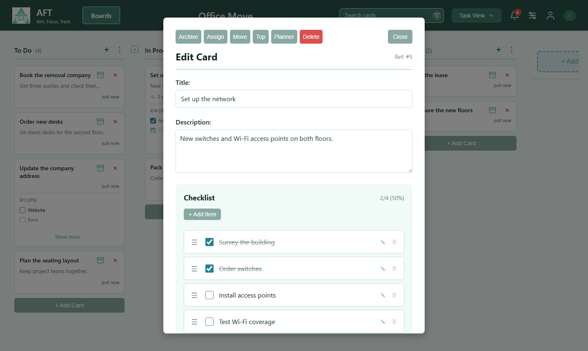

Select a card to open it. Changes save as you leave each field, and a small "Saved" indicator confirms it.

- **Enter** saves and closes the card, **Shift+Enter** adds a new line, and **Escape** reverts the field you're editing, then closes the card. On touchscreens, Enter adds a new line in descriptions and comments
- **New cards** can start with dates, a duration, assignees, a checklist and a schedule, using the same keyboard rules as editing
- **Move a card** by dragging it to another column or position
- **Assignees**: set a primary assignee and optional secondary assignees from the users with access to the board. Cards show the primary assignee's initials in their profile colour
- **Dates and times** use a picker with minutes in steps of 5. To enter an exact minute, type it into the field
- **Timestamps**: cards show when they were last updated, and the edit modal shows created and updated times. Checklist items show theirs in a tooltip. Reordering doesn't change a card's timestamp, and adding or editing a comment or checklist item does

### Checklists and Comments

- **Checklists** break a card down into subtasks that you can edit, tick off and delete
- **Comments** are listed with timestamps. You can edit or delete them, and edited comments are marked as edited

### Searching and Filtering

Search from the header. It matches card titles, descriptions and checklist items.

- Spaces mean AND, and commas mean OR
- Use quotes for an exact phrase. Double a quote inside a phrase to search for a literal quote
- `#123` finds the card with ID 123. Use `"#123"` to search for that text instead

Select the filter icon in the search field to filter by assignee, include unassigned cards, and optionally match secondary assignees. An indicator next to the board name shows when filters are active. **Clear Filters** in the board menu removes them all.

### Views

Switch view from the views dropdown in the header: Task, Scheduled, Archived and Planner, plus the Done View on Agile boards.

### Archiving Cards

Archive a card to take it off the board and keep its history. Find it in the Archived View, where you can unarchive it. Column menus can archive or unarchive in bulk.

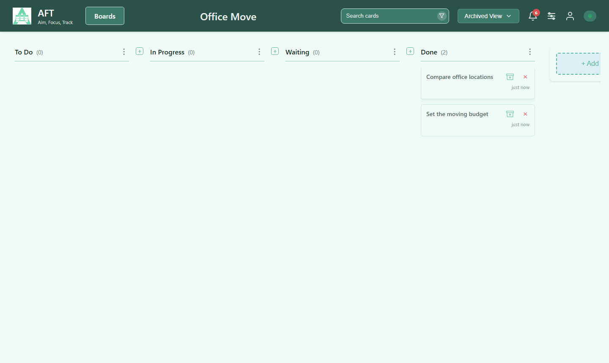

## Compact Cards

On a busy board, choose **Compact Cards** in the views dropdown to show only each card's title. Choose it again to bring back descriptions and checklists. On mobile it's in the Views section of the menu.

The setting is remembered for each board in this browser. It doesn't change what other people see.

## Card Actions

Choose which buttons appear on board cards in **Card Actions** in your Profile preferences. Pick up to 3 of Done, Archive, Move, Move to top and Delete, separately for desktop and mobile. For example, on an Agile board you could show Done and hide Delete.

**Move to top** sends a card to the top of its whole column, even when a search, filter or view is hiding other cards. You can filter a long column to find a card, move it up, and it will be first when you clear the filter. It's also on the Top button when you open a card, and on the <kbd>T</kbd> shortcut. After typing in the search box, click away from it first, or the T is typed into the search.

Every action is still there when you open a card. Unarchive always shows on cards in the Archived View.

## Scheduled Cards

Scheduled cards are templates that create a card on a repeating schedule, for jobs like regular maintenance, bin day or monthly accounts.

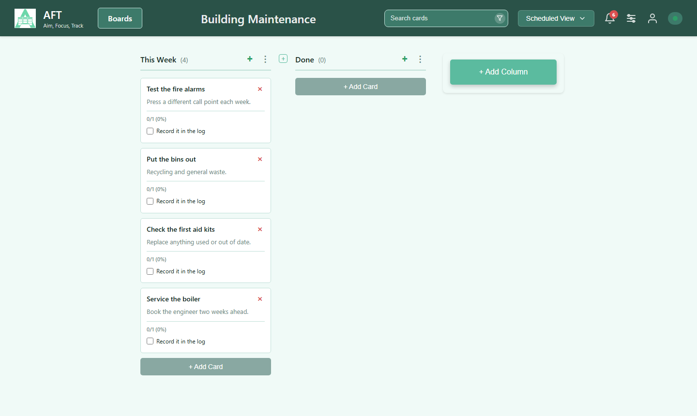

- **Create a schedule** from a new or existing card, then manage it in the Scheduled View
- **Frequency**: every N minutes, hours, days, weeks, months or years, from a start date and time, with an optional end date. A schedule turns itself off at its end date
- **Preview**: see the next 4 run times before saving
- **Duplicates**: choose whether a new card is created while an earlier one is still open in the column
- **Enable or disable** a schedule without deleting it
- **Create card now** makes a one-off card straight away without changing the run times. It works even on disabled schedules and when duplicates are off
- **What's copied**: new cards get the template's checklist, and a comment records which schedule created them

Schedules are checked every minute. Administrators can also create cards for a date and time range, see [System Info](administration.md#system-info).

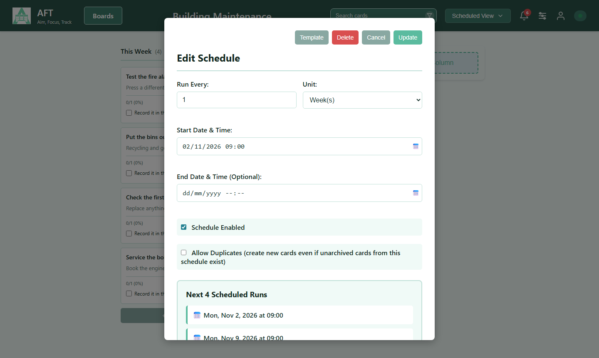

## Planner View

The Planner shows a board's cards on a calendar.

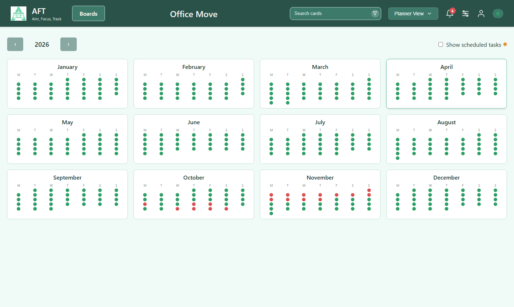

- **Year view**: 12 small months, with coloured dots for days that are free, busy with cards, or have scheduled cards coming up. Select a month to open it
- **Month view**: a full calendar with cards shown on the days they span. Use **Back** to return to the year
- **Change date**: select a card to edit it, or to place it by selecting a new start date in the year view
- **Add a card**: select an empty day in the month view to create a card on that date
- **Busy days**: days with more than three cards show a **+N more** button
- **Toggles**: **Show scheduled tasks** adds upcoming recurring cards in both views. **Show columns** and **Show times** add detail in the month view

## Working Style

AFT supports different working styles to accommodate various team preferences and workflows. The working style in your Profile preferences is the default for boards you create in the future. To change the style of an existing board, use that board's menu.

### Available Working Styles

There are two main working styles available:

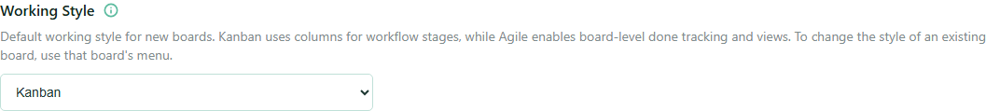

- **Kanban** - Traditional column-based workflow where cards move through stages (To Do, In Progress, Done, etc.)
- **Agile** - Boards represent work categories, and columns represent task statuses or subcategories within those boards

### Done/Not Done Functionality

When using Agile working style, cards display a **Done button** that allows you to mark individual cards as complete without moving them:

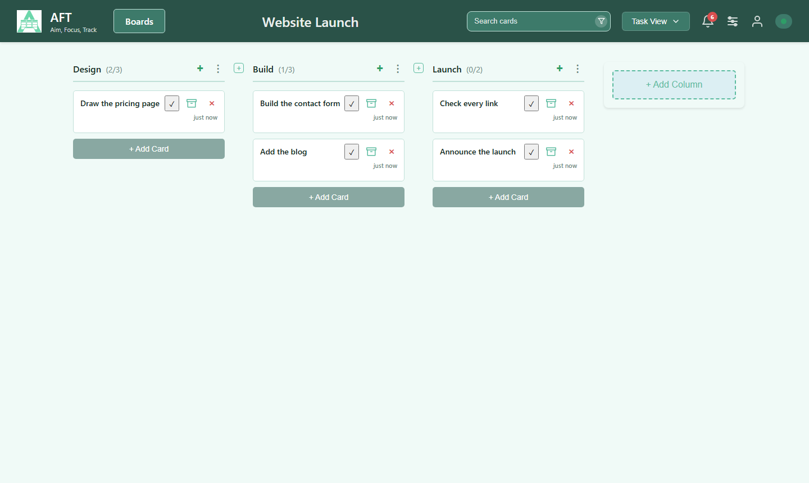

The Done button provides:

- Quick visual indicator of task completion status
- Ability to mark tasks complete without moving cards between columns
- Dynamic column count updates showing total cards and completed cards

Whichever style you use, moving a card into a column named `done`, `complete`, `completed`, `finished`, `resolved`, `closed` or `shipped` records when it was finished. The column name isn't case sensitive.

### Done View

A dedicated "Done View" is available from the views dropdown. It displays only the cards you've marked as done across all columns, so you can review completed work.

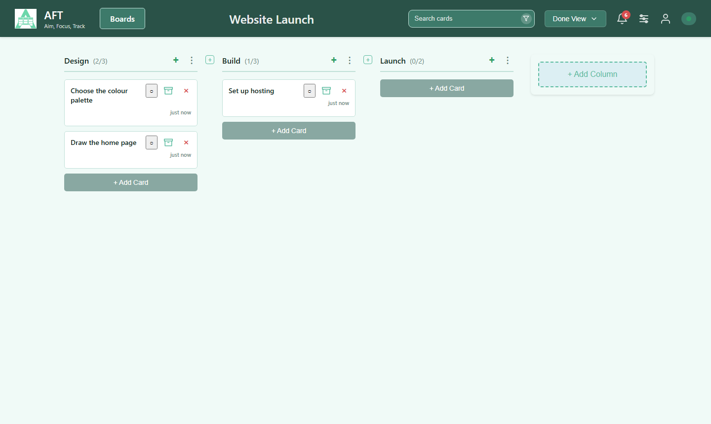

### Archiving Agile Cards

Agile cards also have an **Archive button**. Use it to take a card off the board without marking it done, for example a feature you decided not to build. You keep the card and its history.

- Archived cards appear in the Archived View, in the views dropdown, and can be found there with the board search
- The Archived View is available in both working styles. In Agile it lists done and not-done archived cards together
- Unarchiving a card returns it to the board with its done status unchanged
- On mobile, open the card to find the Archive button

### Column Count Updates

In the Agile Task View, column headers show both counts in parentheses:

- **Done Count** - Number of cards marked as done in the column
- **Total Count** - Total number of cards in the column (all cards regardless of done status)
- For example: "To Do (2/5)" means 5 total cards with 2 marked as done

The Done View shows only the done count.

## Preferences

Your own settings are on your **Profile** page, under **Preferences**.

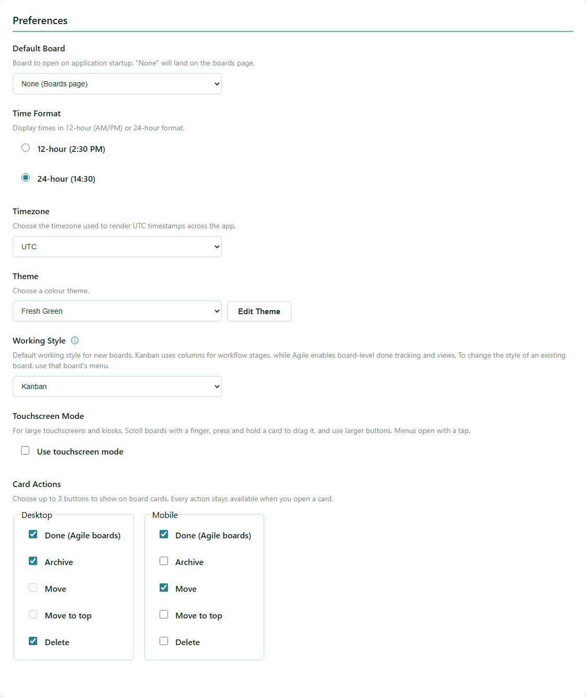

- **Default Board**: the board to open on startup
- **Time Format**: 12-hour or 24-hour
- **Timezone**: used to show times across the app
- **Theme**: your colour theme
- **Working Style**: the default for new boards, see [Working Style](#working-style)
- **Touchscreen Mode**: for large touchscreens and kiosks. Scroll boards with a finger, press and hold a card to drag it, and use larger buttons, with menus that open by tap
- **Card Actions**: see [Card Actions](#card-actions)

Your Profile page is also where you change your password, choose your profile colour, and add passkeys if your administrator has turned them on.

## Themes

The Theme Builder creates colour themes for the whole application. Open it from the **Theme Builder** tab in Instance Settings.

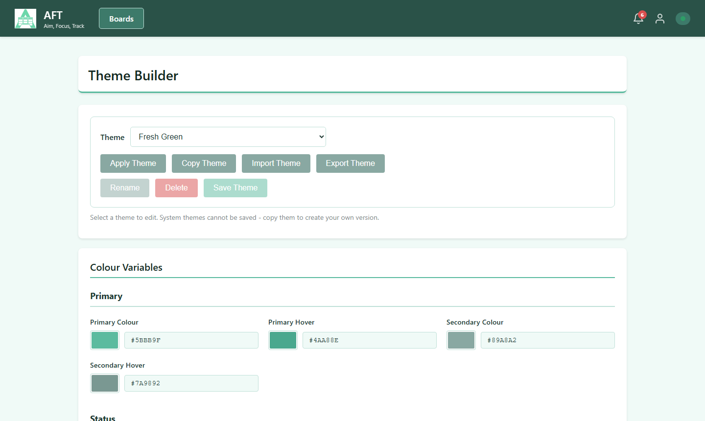

- **System themes**: Default, At the Beach, Dark Mode, Welcome to the Jungle and Fresh Green. These can't be changed, and neither can themes promoted to global, so copy one to make your own version
- **Your themes**: edit every colour, including primary and secondary colours, status colours, text, backgrounds and the header, with a live preview. You can rename themes, and share them by exporting and importing JSON files
- **Background images**: choose an included background or upload your own. Uploads are kept in a Docker volume, so they survive restarts
- **Global themes**: users with `branding.edit` can promote a theme so everyone can select and copy it, and demote it again later, from Instance Settings

## Install as an App

AFT can be installed as an app on your phone, tablet, Mac or PC, for a full-screen window with no browser address bar. Your instance needs valid HTTPS for this.

- **Mac or PC (Chrome or Edge)**: open AFT, then select the install icon in the address bar, or **Install AFT** in the browser menu
- **Android (Chrome)**: open AFT, open the three-dots menu and choose **Install app**, or use the **Install App** button in your Profile preferences
- **iPhone or iPad (Safari)**: open AFT, select Share, then **Add to Home Screen**

## Notifications

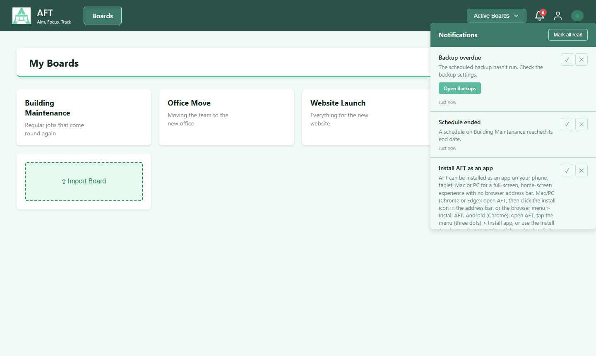

The bell in the header shows your unread count and lists your notifications, which can have an action button. You can mark them as read and delete them, one at a time or all together.

Administrators are notified about overdue or failed backups, schedule errors and ended schedules, and new AFT releases.
